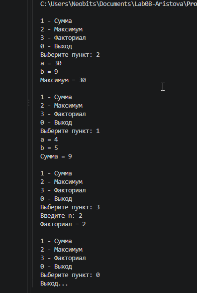
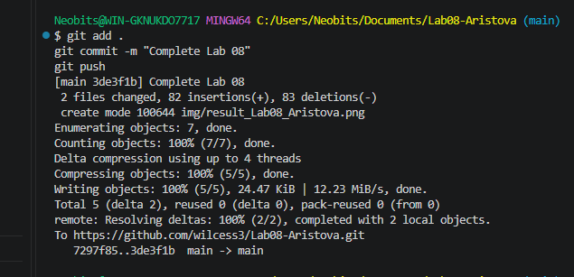

# Практическая работа №8

**ФИО:** Аристова Анастасия Александровна 
**Группа:** ИСП-241
**Дата:** 22.10.2026

## Что изучено

- Научилась объявлять и вызывать свои методы. Метод с void просто что-то делает (например, печатает линию), а метод с int или bool обязан вернуть результат через return
- Поняла, зачем нужны параметры: через них в метод передаются данные. Один и тот же метод можно вызывать с разными числами или массивами
- Узнала, что повторяющийся код лучше выносить в метод. Тогда если нужно что-то исправить, делаешь это в одном месте, а не копируешь три раза

## Скриншоты

